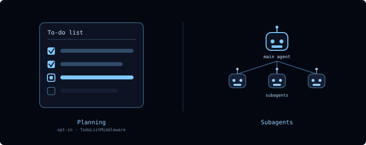
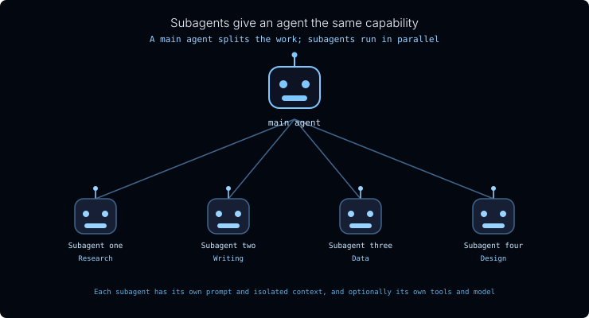
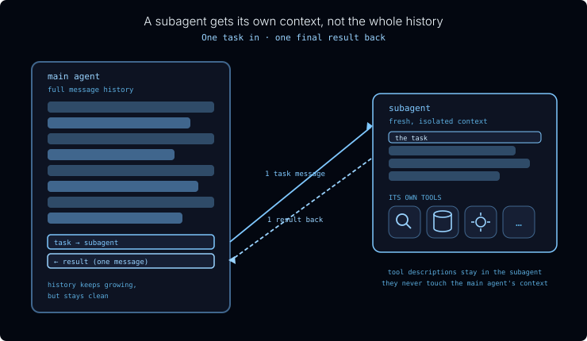
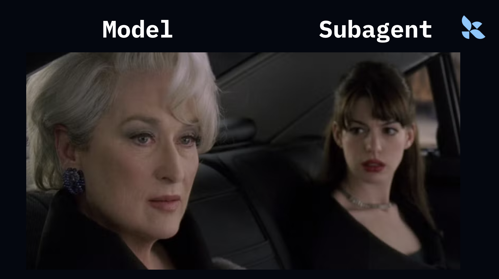
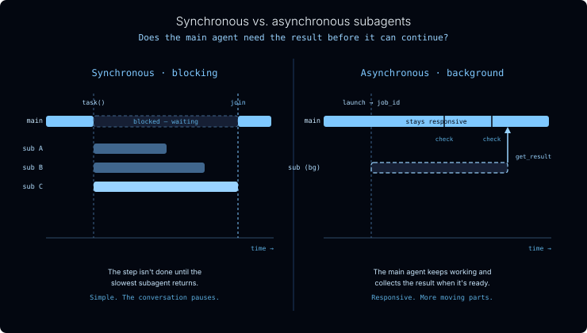

[For translation, open lesson in new tab and use Chrome translate](https://langchain-ai.github.io/lca-lessons/deepagents/m4/m4.1-delegation.html)

<style>@import url('../shared/sd-components.css');</style>
<script src="../shared/sd-components.js"></script>

<div class="page-lang-switch" data-page-lang-switch>
  <button class="page-lang-btn" data-page-lang="python" aria-selected="false">Python</button>
  <button class="page-lang-btn" data-page-lang="typescript" aria-selected="false">TypeScript</button>
</div>

# Delegation

<style>
.lt-bar {
  display: flex;
  flex-wrap: wrap;
  gap: 20px;
  margin: 28px 0 0;
  border-bottom: 2px solid #CCE9FF;
}
.lt-group { display: flex; gap: 3px; }
.lt-quiz  { --c: #7C3AED; }
.lt-del   { --c: #CA8A04; }
.lt-tab {
  font: 500 14px 'IBM Plex Mono', monospace;
  padding: 9px 14px;
  border: none;
  background: transparent;
  color: #40668D;
  cursor: pointer;
  border-bottom: 3px solid transparent;
  margin-bottom: -2px;
  border-radius: 6px 6px 0 0;
  transition: background .15s, color .15s, border-color .15s;
  white-space: nowrap;
}
.lt-tab:hover { background: #F2FAFF; color: #030710; }
.lt-tab.active {
  color: var(--c);
  border-bottom-color: var(--c);
  background: #fff;
}
.lt-panel { display: none; padding-top: 24px; }
.lt-panel.active { display: block; }
@media (max-width: 600px) {
  .lt-bar { flex-wrap: nowrap; overflow-x: auto; gap: 12px; }
  .lt-tab { padding: 8px 10px; font-size: 13px; }
}
</style>

<div class="lt-bar" role="tablist" aria-label="Lesson sections">
  <div class="lt-group lt-del">
    <button class="lt-tab active" data-p="del" role="tab" aria-selected="true">Delegation</button>
  </div>
  <div class="lt-group lt-quiz">
    <button class="lt-tab" data-p="quiz" role="tab" aria-selected="false">Quiz</button>
  </div>
</div>

<div class="lt-panel active" id="p-del" markdown="1" role="tabpanel">

<div data-lang="python" markdown="1">

<details style="border:2.5px solid #000;border-radius:6px;background:#fff;margin:1rem 0;"><summary style="padding:10px 16px;cursor:pointer;font-weight:500;font-family:'IBM Plex Mono',monospace;font-size:14px;">Lesson Video Walkthrough</summary><div style="padding:12px 16px 16px;"><div class="video-container" style="max-width:750px;"><div class="video-wrapper"><iframe src="https://share.descript.com/embed/alTbbn0YUNR" frameborder="0" allow="autoplay; fullscreen; encrypted-media; picture-in-picture" allowfullscreen></iframe></div></div></div></details>

</div>

<div data-lang="typescript" markdown="1">

<details style="border:2.5px solid #000;border-radius:6px;background:#fff;margin:1rem 0;"><summary style="padding:10px 16px;cursor:pointer;font-weight:500;font-family:'IBM Plex Mono',monospace;font-size:14px;">Lesson Video Walkthrough (Python)</summary><div style="padding:12px 16px 16px;"><div class="video-container" style="max-width:750px;"><div class="video-wrapper"><iframe src="https://share.descript.com/embed/alTbbn0YUNR" frameborder="0" allow="autoplay; fullscreen; encrypted-media; picture-in-picture" allowfullscreen></iframe></div></div></div></details>

</div>

Long-running agents need coordination. A big task can span many steps, tool calls, files, and intermediate results. Without an explicit way to track the plan and isolate specialized work, the main agent can drift or overload its context.

Deep Agents gives the main agent two coordination tools:

<p align="center">
  
</p>

- **Planning**: `write_todos` keeps a visible task list so the main agent can track what is pending, in progress, and complete. It's opt-in, enabled by adding `TodoListMiddleware` when you build the agent.
- **Delegation**: subagents let the main agent hand focused work to another agent with its own instructions, tools, and context.

Planning and delegation solve different problems. Planning keeps the main agent organized. Delegation moves specialized or context-heavy work out of the main agent's context.

---

## Planning: the to-do list

A capable model can draft a solid plan for a multi-step job. The hard part is follow-through. As the conversation grows and the agent juggles tool calls and intermediate results, it tends to drift, losing track of what's already done and what's still left.

Deep Agents addresses this with an opt-in **`write_todos`** tool: add `TodoListMiddleware` to the agent's `middleware` list and the model gets a tool for writing its plan out as a structured to-do list and updating each item's status as it works:

```python {1,6}
from langchain.agents.middleware import TodoListMiddleware
from deepagents import create_deep_agent

agent = create_deep_agent(
    tools=[...],
    middleware=[TodoListMiddleware()],
)
```

- **`pending`**: not started yet
- **`in_progress`**: being worked on now
- **`completed`**: done

The list is saved in the agent's state. Across turns, it persists when you use the same thread with a checkpointer, following the thread pattern introduced earlier in the course. On a long task the agent always has an explicit, up-to-date plan to check against instead of trying to hold the whole thing in its head. Think of it as writing the steps on a whiteboard and ticking them off as it goes.

Planning is not delegation. It is the supervisor's task list: a way for the main agent to keep itself organized before, during, and after tool calls.

---

## Delegation: how teams tackle a big project

When a project is too big for one person, we bring in a team.

<div style="text-align: center;">
<svg viewBox="0 0 740 394" width="720" role="img" aria-label="A supervisor figure at the top connected by lines to four worker figures below, each labeled with a different skill: Research, Writing, Data, Design. Hover a figure to see its role." xmlns="http://www.w3.org/2000/svg" font-family="'Inter', -apple-system, BlinkMacSystemFont, 'Segoe UI', sans-serif">
  <rect width="740" height="394" fill="#030710" rx="8"/>
  <text x="370" y="34" text-anchor="middle" font-size="15" font-weight="300" fill="#F2FAFF">How people tackle a big project</text>
  <text x="370" y="53" text-anchor="middle" font-size="11" fill="#99D3FF" font-family="'IBM Plex Mono', ui-monospace, SFMono-Regular, Menlo, Consolas, monospace">A supervisor splits the work; specialists run in parallel</text>
  <line x1="370" y1="170" x2="120" y2="246" stroke="#40668D" stroke-width="1.5"/>
  <line x1="370" y1="170" x2="287" y2="246" stroke="#40668D" stroke-width="1.5"/>
  <line x1="370" y1="170" x2="453" y2="246" stroke="#40668D" stroke-width="1.5"/>
  <line x1="370" y1="170" x2="620" y2="246" stroke="#40668D" stroke-width="1.5"/>
  <g style="cursor:pointer">
    <title>Splits the project into tasks and combines the results</title>
    <circle cx="370" cy="98" r="24" fill="#7FC8FF"/>
    <path d="M 332,170 C 332,134 348,126 370,126 C 392,126 408,134 408,170 Z" fill="#7FC8FF"/>
    <text x="370" y="192" text-anchor="middle" font-size="11" fill="#CCE9FF" font-family="'IBM Plex Mono', ui-monospace, SFMono-Regular, Menlo, Consolas, monospace">Supervisor</text>
  </g>
  <g style="cursor:pointer">
    <title>Finds the sources, facts, and background</title>
    <circle cx="120" cy="268" r="20" fill="#40668D"/>
    <path d="M 88,332 C 88,300 102,293 120,293 C 138,293 152,300 152,332 Z" fill="#40668D"/>
    <text x="120" y="356" text-anchor="middle" font-size="10" fill="#B2DEFF" font-family="'IBM Plex Mono', ui-monospace, SFMono-Regular, Menlo, Consolas, monospace">Research</text>
  </g>
  <g style="cursor:pointer">
    <title>Drafts and edits the copy</title>
    <circle cx="287" cy="268" r="20" fill="#40668D"/>
    <path d="M 255,332 C 255,300 269,293 287,293 C 305,293 319,300 319,332 Z" fill="#40668D"/>
    <text x="287" y="356" text-anchor="middle" font-size="10" fill="#B2DEFF" font-family="'IBM Plex Mono', ui-monospace, SFMono-Regular, Menlo, Consolas, monospace">Writing</text>
  </g>
  <g style="cursor:pointer">
    <title>Pulls the numbers and runs the analysis</title>
    <circle cx="453" cy="268" r="20" fill="#40668D"/>
    <path d="M 421,332 C 421,300 435,293 453,293 C 471,293 485,300 485,332 Z" fill="#40668D"/>
    <text x="453" y="356" text-anchor="middle" font-size="10" fill="#B2DEFF" font-family="'IBM Plex Mono', ui-monospace, SFMono-Regular, Menlo, Consolas, monospace">Data</text>
  </g>
  <g style="cursor:pointer">
    <title>Handles the layout and visuals</title>
    <circle cx="620" cy="268" r="20" fill="#40668D"/>
    <path d="M 588,332 C 588,300 602,293 620,293 C 638,293 652,300 652,332 Z" fill="#40668D"/>
    <text x="620" y="356" text-anchor="middle" font-size="10" fill="#B2DEFF" font-family="'IBM Plex Mono', ui-monospace, SFMono-Regular, Menlo, Consolas, monospace">Design</text>
  </g>
  <text x="370" y="380" text-anchor="middle" font-size="9" fill="#5BADDF" font-family="'IBM Plex Mono', ui-monospace, SFMono-Regular, Menlo, Consolas, monospace">Hover over a teammate to see their role</text>
</svg>
</div>

A few things make this work:

- **A supervisor splits the work and pulls it back together.** They break the project into subtasks, hand each one out, and combine what comes back.
- **Each person brings their own expertise.** A researcher, a writer, and a designer each see the problem differently and carry their own tools.
- **People work in parallel.** Three people working at once finish in roughly a third of the time.
- **Each person focuses on their piece, not the whole project.** The writer doesn't need to hold the entire plan in their head, just their assignment.

---

## What a subagent is

A **subagent** is a full agent the main agent can call to do a focused task and report back. It can have its own instructions, tools, skills, model, and isolated context. The team pattern carries straight over.

<p align="center">
  
</p>

- **The main agent splits work and aggregates results.** Say the job is *"write a newsletter summarizing this week's news on a topic."* The main agent can hand each sub-topic to a different subagent. Each one searches, summarizes what it finds, and passes back only the summary, which the main agent stitches into the final newsletter.
- **Each subagent is a full agent in its own right.** It can have its own system prompt, its own skills, its own tools, and it can even run on a different model than the main agent.
- **Subagents run in parallel.** In Deep Agents, a subagent is invoked like a tool, so the main agent can fire off as many as it needs at the same time.
- **Each subagent focuses on its own task and its own context.** This is what makes subagents a context-engineering tool.

> **Subagent-as-tool.** Deep Agents exposes subagents through a built-in `task` tool. To the main agent, delegating looks just like calling any other tool. The main agent calls `task` with an assignment and gets a result back, picking which subagent to use from each one's description, the same way it decides to call any other tool.

---

## Context isolation

<div data-lang="python" markdown="1">

<details style="border:2.5px solid #000;border-radius:6px;background:#fff;margin:1rem 0;"><summary style="padding:10px 16px;cursor:pointer;font-weight:500;font-family:'IBM Plex Mono',monospace;font-size:14px;">Lesson Video Walkthrough</summary><div style="padding:12px 16px 16px;"><div class="video-container" style="max-width:750px;"><div class="video-wrapper"><iframe src="https://share.descript.com/embed/enqK0nl3XXy" frameborder="0" allow="autoplay; fullscreen; encrypted-media; picture-in-picture" allowfullscreen></iframe></div></div></div></details>

</div>

<div data-lang="typescript" markdown="1">

<details style="border:2.5px solid #000;border-radius:6px;background:#fff;margin:1rem 0;"><summary style="padding:10px 16px;cursor:pointer;font-weight:500;font-family:'IBM Plex Mono',monospace;font-size:14px;">Lesson Video Walkthrough (Python)</summary><div style="padding:12px 16px 16px;"><div class="video-container" style="max-width:750px;"><div class="video-wrapper"><iframe src="https://share.descript.com/embed/enqK0nl3XXy" frameborder="0" allow="autoplay; fullscreen; encrypted-media; picture-in-picture" allowfullscreen></iframe></div></div></div></details>

</div>

<p align="center">
  
</p>

This is what makes subagents a context-engineering tool. A subagent does its work without cluttering the main agent's context:

- A subagent receives **one message** from the main agent describing its task. Importantly, it does **not** inherit the main agent's message history.
- It runs autonomously until the task is done, then returns **one message** back: its final result. Each `task` call is a fresh run with no memory of earlier calls, and the subagent can't carry on a back-and-forth with the main agent (shared state such as the agent filesystem can still pass between them).
- A subagent defines **its own tool set**. Consider a database expert with dozens of specialized tools. Putting those behind a subagent keeps every one of those tool descriptions *out* of the main agent's context. All the main agent has to know is that this needs database expertise. It hands off the task and gets back an answer.

The payoff: a large, messy subtask gets compressed into a single clean result, as long as the subagent is told to return a concise summary. The main agent's context stays focused on coordination, even as the work piles up behind the scenes.

<details markdown="1" style="border:2.5px solid #000;border-radius:6px;background:#fff;margin:1rem 0;"><summary style="padding:10px 16px;cursor:pointer;font-weight:500;font-family:'IBM Plex Mono',monospace;font-size:14px;">The Devil Wears Prada Analogy</summary><div style="padding:12px 16px 16px;" markdown="1">

<p align="center">
  
</p>

If you've seen *The Devil Wears Prada*, this is basically it: Miranda Priestly doesn't want to hear how Andy got something done, just the result. Subagent = Andy Sachs; the subagent does the messy work and hands the main agent only what it needs to know, not tool call noise or irrelevant details.

Miranda also doesn't wait on one assistant at a time: she sends several off at once, each on their own errand. A main agent can do the same, running multiple subagents in parallel, each in its own separate context.

<p align="center">
  
</p>

</div></details>

<div data-lang="python" markdown="1">

<div style="border:2px solid #B45309;border-radius:6px;background:#FFF8E5;padding:12px 16px;margin:1rem 0;" markdown="1">

**New update: fork mode (experimental).** By default, a subagent only sees the task description it's given. Set `"mode": "fork"` to see the parent's conversation so far and use the parent's system prompt instead.

```python
reviewer = {
    "name": "reviewer",
    "description": "Review the plan we just discussed.",
    "mode": "fork",
}
```

Use it when the subagent needs context from the conversation that would be hard to write into a task description. The cost is a larger context for the subagent. A forked subagent can't set its own `skills` (it uses the parent's).

Added in deepagents 0.7.12. The labs don't use it.
</div>

</div>

<div data-lang="typescript" markdown="1">

<div style="border:2px solid #B45309;border-radius:6px;background:#FFF8E5;padding:12px 16px;margin:1rem 0;" markdown="1">

**New update: fork mode (experimental).** By default, a subagent only sees the task description it's given. Set `mode: "fork"` to see the parent's conversation so far and use the parent's system prompt instead.

```typescript
const reviewer: SubAgent = {
  name: "reviewer",
  description: "Review the plan we just discussed.",
  mode: "fork",
};
```

Use it when the subagent needs context from the conversation that would be hard to write into a task description. The cost is a larger context for the subagent. A forked subagent can't set its own `skills` (it uses the parent's).

The labs don't use it.
</div>

</div>

---

## Synchronous vs. asynchronous

Subagents can run in two modes. The choice comes down to one question: **does the main agent need the result before it can keep going?**

<p align="center">
  
</p>

- **Synchronous** subagents complete their task within the step. The main agent blocks until the longest-running subagent returns. It's the simplest model, but the conversation pauses while the work happens.
- **Asynchronous** subagents run in the background. The main agent launches the job, stays responsive, and checks on it later, collecting the result once it's ready. It's more responsive but has more moving parts.

This course uses synchronous subagents in the hands-on lab. Async subagents are useful for production/background workflows where the main agent should stay responsive while longer work continues elsewhere.

---

## When to reach for a subagent

<Tip>

**Use a subagent when:**

- A multi-step task would otherwise clutter the main agent's context
- The work needs a specialized domain: custom instructions or its own tools
- A subtask is better served by a different model
- You want the main agent to stay focused on high-level coordination

**Skip the subagent when:**

- The task is simple and single-step, so the overhead isn't worth it
- You need to keep the intermediate context, not just the final result

</Tip>

---

## Recap

In this lesson you learned how planning and delegation support long-running agents:

- **Planning** keeps the main agent organized with a visible `write_todos` task list, opt-in via `TodoListMiddleware`.
- **Delegation** lets the main agent split a big job into pieces, run them in parallel, and stay focused on coordination.
- A subagent is **a full agent in its own right**, with its own prompt and isolated context, and optionally its own tools, skills, and model, invoked through the built-in **`task`** tool.
- Subagents are a **context-engineering** tool. At the hand-off boundary, a subagent gets **one task in** and returns **one final result back** (internally it may take many steps), keeping its work and its tool descriptions out of the main agent's context.
- Synchronous subagents block until they return; async subagents are for background workflows where the main agent should stay responsive.

---

## Next

Complete the **Quiz** above, then continue to the next lesson where you'll build a subagent team: a main agent that fans out parallel searches to subagents and synthesizes their results into a weekly newsletter.

---

## References

**Documentation:**

- [Delegation (Deep Agents)](https://docs.langchain.com/oss/python/deepagents/subagents#why-use-subagents)
- [Subagents (Deep Agents)](https://docs.langchain.com/oss/python/deepagents/subagents)
- [Async subagents (Deep Agents)](https://docs.langchain.com/oss/python/deepagents/async-subagents)
- [Context engineering (Deep Agents)](https://docs.langchain.com/oss/python/deepagents/context-engineering)

**Blog:**

- [Running subagents in the background](https://www.langchain.com/blog/running-subagents-in-the-background)

<div data-lang="python" markdown="1">

<div markdown="1" style="background:#F2FAFF;border:1px solid #CCE9FF;border-radius:8px;padding:14px 20px;margin:1rem 0;">

**Go deeper: read the source** *(optional)*

*The lesson shows how to use this. To see how it's implemented, start with these files:*

- [`middleware/subagents.py`](https://github.com/langchain-ai/deepagents/blob/main/libs/deepagents/deepagents/middleware/subagents.py): the `task` tool and how subagents are built and run

</div>

</div>
<div data-lang="typescript" markdown="1">

<div markdown="1" style="background:#F2FAFF;border:1px solid #CCE9FF;border-radius:8px;padding:14px 20px;margin:1rem 0;">

**Go deeper: read the source** *(optional)*

*The lesson shows how to use this. To see how it's implemented, start with these files:*

- [`middleware/subagents.ts`](https://github.com/langchain-ai/deepagentsjs/blob/main/libs/deepagents/src/middleware/subagents.ts): the `task` tool and how subagents are built and run

</div>

</div>

</div>

<div class="lt-panel" id="p-quiz" role="tabpanel">

<h2>Check your understanding</h2>

<MCQ
    question="You build a deep agent with just a model and a search tool, and no middleware argument. On a 12-step job, the trace never shows a write_todos call. What is the most likely reason?"
    choices='["write_todos needs a checkpointer, and is removed when none is passed", "write_todos only appears after summarization compacts the history", "write_todos is opt-in and needs TodoListMiddleware in the list", "write_todos is only given to subagents, so planning must be delegated"]'
    correctIndex={2}
    explanation="write_todos is opt-in: add TodoListMiddleware to the agent&#39;s middleware list to get it. The default stack does not include it."
/>

<MCQ
    question="The main agent needs four independent research jobs done by synchronous subagents. What would you most likely see in the trace?"
    choices='["Four task calls in one AIMessage; the main agent resumes once all return", "One task call carrying all four jobs, worked through by a single subagent", "Four task calls over four turns, since only one can be pending at a time", "Four start_async_task calls, and a reply before any subagent finishes"]'
    correctIndex={0}
    explanation="A subagent is invoked through the task tool like any other tool, so the model can issue several task calls in one step. With synchronous subagents, the main agent blocks until the slowest one returns."
/>

<MCQ
    question="A subagent reads 30 web pages and makes 40 tool calls before it finishes. What is added to the main agent&#39;s message history?"
    choices='["All 40 tool calls and results, appended after the task call", "A summary of the 40 steps written by SummarizationMiddleware", "One ToolMessage containing the subagent&#39;s final reply", "Nothing, until the main agent reads the subagent&#39;s output file"]'
    correctIndex={2}
    explanation="The subagent starts from one message describing its task and works in its own context. When it finishes, only its final reply comes back to the main agent&#39;s messages, as the result of the task tool call. Its intermediate steps stay out of the main agent&#39;s message history."
/>

<MCQ
    question="A user wants to keep chatting while a 20-minute research job runs. Which setup fits better, and why?"
    choices='["A sync subagent, since parallel task calls never block the user", "A sync subagent with a checkpointer, so the pause can resume later", "An async subagent, since it shares context and can reply directly", "An async subagent: the main agent gets a task ID and stays free"]'
    correctIndex={3}
    explanation="A synchronous subagent blocks the main agent until it returns. An asynchronous subagent runs in the background: the main agent gets a task ID back right away and can keep talking, then check on the job later."
/>
</div>

<script>
(function () {
  var tabs = document.querySelectorAll('.lt-tab');
  function show(p) {
    tabs.forEach(function (t) {
      var on = t.getAttribute('data-p') === p;
      t.classList.toggle('active', on);
      t.setAttribute('aria-selected', on ? 'true' : 'false');
    });
    document.querySelectorAll('.lt-panel').forEach(function (panel) {
      panel.classList.toggle('active', panel.id === 'p-' + p);
    });
  }
  tabs.forEach(function (t) {
    t.addEventListener('click', function () { show(t.getAttribute('data-p')); });
  });
})();
</script>
